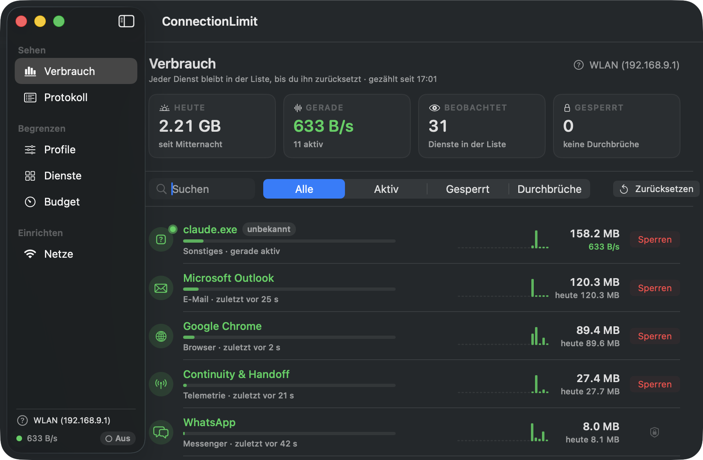

# ConnectionLimit

See who is burning through your data on a Mac — and shut them off.
Built for the situation where data is scarce: hotspot, roaming, hotel tariff.

macOS shows no per-app usage and has no Low Data Mode like iOS. This tool
closes both gaps as far as that is possible without Apple entitlements — and
says plainly where the limit runs.



```
$ connlimit tracked

Getrackte Dienste  ·  seit 25.08. 17:01  ·  Netz: iPhone von Marco [teuer]

  DIENST                KLASSE          GESAMT     HEUTE  ZULETZT   VERLAUF 24 h
● Google Chrome         Browser       412.7 MB  26.4 MB  gerade    ▁▂▃▅█▆▃▂▁▁▂▃
● Microsoft Outlook     E-Mail        119.3 MB  12.1 MB  gerade    ▂▃▂▁▁▂▅▃▂▁▁▁
⚠ OneDrive              Cloud-Sync     64.0 MB   1.4 MB  gerade    ▁▁▁▂▁▁▁▂▁▁▁▁
  ↳ 3× trotz Sperre aktiv · 1.4 MB · zuletzt 12:04
🔒 iCloud Fotos         Cloud-Sync    180.2 MB       —  vor 8 min  ▃▅▂▁▁·······
  macOS Update          Updates        29.0 MB       —  vor 39 min ▁▁·········
```

The app and the command line speak **German and English** — switch in the menu bar (the `DE`/`EN` button), in the window's sidebar, or with `connlimit lang <de|en|auto>`. By default it follows the macOS language. The source comments are in German; this document is not.

## The idea

**You don't tell the app you're travelling — the network does.**

Every network is recognised by the MAC address of its router (no location
services needed, unlike reading the SSID) and classified once as *free*,
*metered* or *limited*. At the iPhone hotspot the vacation profile kicks in by
itself, and at home it falls away again on its own. That is exactly where the
expensive mistakes happen otherwise: forgetting to switch it on when you
arrive, forgetting to switch it off when you get back.

Four escalation tiers block **classes**, not individual apps — so they also
cover services that didn't exist when the profile was written:

| Tier | blocks by default |
|---|---|
| **Off** | nothing |
| **Frugal** | updates, backups, telemetry, media — costs you no comfort |
| **Vacation** | plus cloud sync (iCloud, OneDrive, Dropbox, Nextcloud) |
| **Emergency** | plus mail and browsers |

Which classes a tier blocks is **configurable** — in the *Profile* section of
the window or with `connlimit profile edit`. The table above is the default,
not a law. Only two things are non-negotiable: "Off" blocks nothing, and the
`essential` class (VPN, DNS, push, the tool itself) is hard-protected against
every block, including its own automation.

## The list stays

Whatever once used data stays in the list — until you reset it.

That sounds like a detail, but it is the difference between "what is running
right now?" and "who is costing me money?". A sync client that uploads 40 MB
for ten seconds every twenty minutes is almost never visible in a snapshot —
and it is precisely the one you want to block. Hence:

- **Persistent tracking** — every service ever seen stays listed, with total
  volume, today's volume and the time of its last activity. Currently active
  ones sort to the top and are **green**.
- **Volume over time** — hourly and daily buckets per service. Quiet buckets
  are shown as zero rather than skipped: otherwise silence would look like
  light traffic.
- **Log** — when something was blocked, when it was released, and when data
  flowed *despite* a block being in place. With start, end and volume.

The last point matters most. Whether bytes that got through were a real
connection attempt cannot be determined without a network filter — what is
measurable is that bytes were counted while the block was standing. That, and
nothing more, is what gets recorded. A block that leaks is worse than no block,
because you rely on it.

Colours mean the same thing everywhere — window, menu bar and terminal:

| | |
|---|---|
| **green** | moving data right now |
| **red** | blocked |
| **orange** | blocked, and data is flowing anyway |
| **grey** | known, but quiet |

## Building

Requires macOS 14+ and Swift 6. Xcode is **not** needed.

```bash
swift build -c release              # CLI
./Tools/make-app-bundle.sh          # menu bar app into dist/
swift run connlimit-selftest        # test suite (161 checks)
./Tools/check-l10n.sh               # every German text has an English translation
```

`Tools/make-app-bundle.sh` assembles the `.app` bundle by hand, draws the icon
(`Tools/make-icon.swift`) and signs it — with your Developer ID if one is in
the keychain, ad hoc otherwise. Without Xcode there is no app target to do
this for you.

The test suite runs as a standalone program rather than under XCTest: both
test frameworks require a full Xcode install, and only the Command Line Tools
are assumed here.

## Installing

On a Mac without a checkout — a second machine, say — take the released build:

```bash
curl -fsSL https://raw.githubusercontent.com/mitsol/connectionlimit/main/Tools/install-release.sh | bash
```

That fetches the latest release, puts the app into `/Applications`, links
`connlimit` onto your `PATH` and sets up the autostart. No Xcode, no Swift, no
`sudo`. If you'd rather not pipe a script into a shell — fair — download the
DMG from the [releases page](https://github.com/mitsol/connectionlimit/releases),
drag the app into Programme and double-click it. It is notarised, so that just
works; you then only miss the command line and the autostart.

From a checkout, build and install in one step:

```bash
./Tools/install.sh
```

Builds, puts the app into `/Applications`, links `connlimit` into the first
writable directory on your `PATH` (`~/.local/bin`, else Homebrew), and sets up
a LaunchAgent. No `sudo`.

The autostart is not a nicety: **measurement only happens while the program is
running.** Without it you lose the stretch between login and your first click
every single day — which is exactly when updates and sync clients like to
fetch. If you don't want it: `CONNLIMIT_NO_AUTOSTART=1 ./Tools/install.sh`.
The LaunchAgent deliberately sets no `KeepAlive` — "Quit" in the menu has to
mean quit.

`./Tools/uninstall.sh` reverses everything: it lifts all blocks first, then
removes autostart, app and symlink. Measurement data is kept unless you set
`CONNLIMIT_KEEP_DATA=0`.

### Distributable package

`./Tools/make-download.sh` builds a universal binary (Apple Silicon and Intel)
as a DMG into `web/public/download/` — the package the website offers. Universal
has to be done by hand: `swift build --arch arm64 --arch x86_64` requires a full
Xcode, while cross-compiling for the other architecture on its own does not —
`lipo` merges the two afterwards. Version, size and checksum are written to
`web/src/lib/build-info.json`, which the website reads, so that it can never
claim something different from the file it serves.

### Signing and notarising

Without a certificate the build is signed ad hoc — Gatekeeper then refuses the
first double-click, and the website explains the detour through the context
menu. With a Developer ID certificate both go away. Notarisation itself costs
nothing extra; it is included in the Apple Developer Program membership.

```bash
# once: store credentials in the keychain (prompts for the app-specific
# password interactively, so it never lands in your shell history)
xcrun notarytool store-credentials connectionlimit \
  --apple-id <apple-id> --team-id <team-id>

CONNLIMIT_NOTARY_PROFILE=connectionlimit ./Tools/make-download.sh
```

The script then signs with hardened runtime and a timestamp, submits app and
disk image separately, staples both tickets and records `notarized: true` in
the build info. The Gatekeeper step disappears from the website by itself — it
cannot claim notarisation, it reads it from the build.

The certificate is found rather than configured: without
`CONNLIMIT_SIGN_IDENTITY` the script picks the first "Developer ID
Application" from the keychain.

## Getting started

```bash
connlimit doctor                    # what is available on this Mac?
connlimit net set current metered   # classify the current network (or: teuer)
connlimit budget set 5GB --until 2026-09-06
connlimit run -v                    # background service, if you don't use the app
```

The menu bar app and `connlimit run` run the same schedule — measuring, switching the profile when the network changes, expiring timers, budget escalation. Use one of them, not both: two samplers writing into the same database would count every byte twice.

As long as a network is **unclassified**, the tool deliberately blocks nothing.
On first launch your home Wi-Fi is unknown too; freezing services there
unasked would be the wrong kind of surprise.

## Commands

| | |
|---|---|
| `tracked [--active] [--limit 30]` | the persistent list: everything that ever used data |
| `top [--since 1h\|today\|7d] [--metered]` | usage per service over a period |
| `watch` | live view of who is sending right now |
| `history <service> [--since 24h] [--bucket 1h]` | volume over time |
| `events [<service>] [--attempts]` | log: blocks, releases, leaks |
| `status` | network, profile, budget, active blocks |
| `services [--class sync]` | service catalogue with the available levers |
| `block <service> [--for 30m]` | block, optionally with a timer |
| `allow <service> [--for 30m]` | release; with `--for` the release expires |
| `unblock-all` | emergency stop |
| `profile <off\|frugal\|vacation\|emergency\|auto>` | set the tier (German names work too) |
| `profile edit <tier> <classes…>` | define what a tier blocks |
| `except <allow\|block\|clear> <service>` | permanent exception from the profile |
| `reset <service> \| --all` | reset the persistent list |
| `net [list\|set\|name]` | classify and name networks |
| `budget [show\|set\|clear]` | travel budget |
| `run [--read-only] [-v]` | background service |
| `doctor` | availability check |
| `lang [de\|en\|auto]` | language of app and terminal |

The most useful move in daily life is `allow <service> --for 30m`: the service
is released for a window and blocked again automatically afterwards. The tool
then reports what the release cost you — *"Dropbox: 240 MB in 30 minutes"*.
That feedback is where the actual learning happens.

## What it can do — and what it can't

Measurement goes through `nettop`. That gives per-process byte counters without
special privileges, but it is a **sampling method**: processes that appear and
disappear between two samples are missed. The numbers are good estimates, not
billing records.

Blocking gets more uncomfortable. Without an Apple entitlement, macOS offers
**no** way to take the network away from a single app. Hence the graduated
levers:

| Lever | Effect | Privileges |
|---|---|---|
| **Pause system service** | `launchctl kill SIGSTOP` — clean, fully reversible, stops the volume at the source | root |
| **Block destination addresses** | own PF anchor; the app stays usable, but CDN addresses can move | root + `install-pf` |
| **Freeze app** | `SIGSTOP` — freezes the **whole** app, not just its network | none |

For pure sync clients, freezing is exactly what you want. For mail or browsers
it is blunt, and the interface says so on every affected row.

**Without `sudo` only the last lever remains.** Services whose levers all need
root — macOS updates, iCloud, Time Machine — keep running despite an active
profile. The tool reports that explicitly instead of displaying "vacation mode
active" while the biggest consumers merrily download.

Real per-app blocking would need a `NEFilterDataProvider` as a system
extension. That requires the Apple Developer Program, an entitlement Apple has
to grant, and Xcode. The architecture keeps the seat warm for it (the
`Enforcer` protocol); it is not implemented.

## Safety net

An app with these powers must not leave anything behind:

- Every block gets a **receipt in the database before** it is applied. A crash
  in between leaves an ineffective receipt — harmless. The other way round
  would leave a frozen app with no trace of it.
- **Never freeze your own process or one of its ancestors.** If the tool is
  driven from a terminal, that terminal is an ancestor — and a frozen terminal
  cannot issue the command to thaw it again. The block would be permanent.
- On startup, recovery cleans up: expired timers, dead processes, rules from a
  different network. **When in doubt, release.**
- On exit all profile blocks are lifted. Manual blocks stay — the user set
  those deliberately.
- PF rules live in their own anchor; `/etc/pf.conf` is backed up before it is
  touched, and `uninstall-pf` restores the original state.
- `connlimit unblock-all` lifts everything regardless of what the database
  thinks.
- Resetting the persistent list deletes **no** measurement data — the budget
  depends on it.

## Layout

```
Sources/
  ConnLimitCore/       sampling · catalogue · network identity · policy · enforcement · store
  connlimit/           command line
  ConnectionLimitApp/  SwiftUI menu bar and window
  selftest/            test suite as its own program
Tools/                 build, install, draw the icon, take screenshots
web/                   website (Vite + React)
```

Data lives in `~/Library/Application Support/at.mitsol.connectionlimit/` —
`connlimit.db` (SQLite) and the optional `catalog.json` for your own service
definitions.

## Website

```bash
cd web
npm install
npm run dev        # development
npm run build      # into web/dist/
```

The site rebuilds the interface as real markup and plays through what the tool
does, alongside the screenshots produced by `Tools/make-screenshots.sh`.

It is bilingual too: a `DE | EN` switch in the navigation, `?lang=en` for links in a given language. English screenshots come from `Tools/make-screenshots.sh en` (into `web/public/screenshots/en/`); until they exist, the English page falls back to the German ones and says so.

## Licence

MIT — see [LICENSE](LICENSE).
